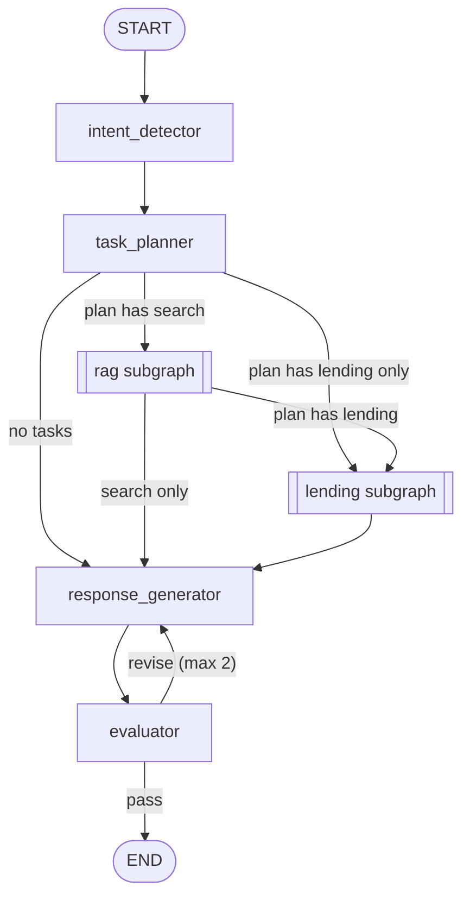
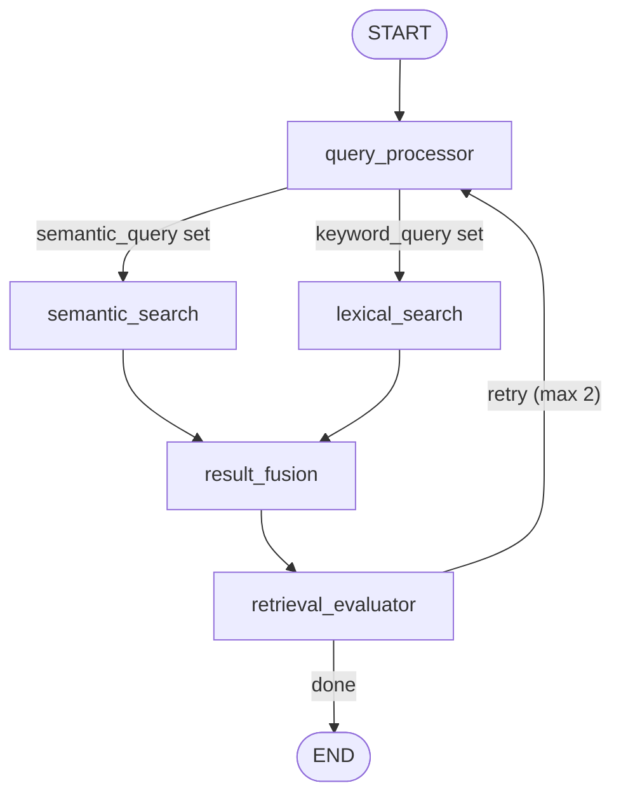
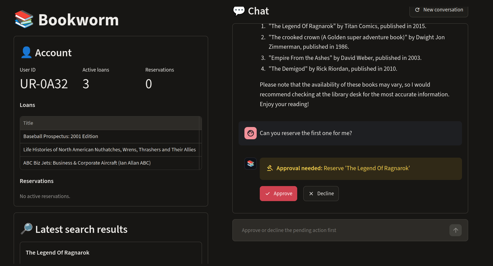

# 📚 Bookworm: an agentic RAG library assistant

Bookworm is a chatbot prototype for a public library. A patron can search the
catalogue in plain language ("a dark psychological thriller", "books by Mercer
Mayer", "the one about a taxidermist in 1917 New York"), check whether a book is
available, and reserve books, cancel reservations or renew loans. The patron
approves every change before it is made.

It is built with **LangGraph**, a local **Mistral 7B** served by **Ollama**,
**Qdrant** for hybrid (dense + BM25) search and **SQLite** for the lending data,
with a **Streamlit** UI. Everything runs in Docker Compose.

---

## Contents

1. [Problem and goals](#1-problem-and-goals)
2. [Architecture](#2-architecture)
3. [Data source and ingestion](#3-data-source-and-ingestion)
4. [Model choice](#4-model-choice)
5. [User interface](#5-user-interface)
6. [Evaluation](#6-evaluation)
7. [Load test and bottleneck analysis](#7-load-test-and-bottleneck-analysis)
8. [Installation and running](#8-installation-and-running)
9. [Project layout](#9-project-layout)
10. [Limitations and future work](#10-limitations-and-future-work)

---

## 1. Problem and goals

### Why this problem is relevant

Library catalogue search usually means keyword search over titles and authors.
Patrons often don't know the exact title. They remember a plot, a mood or a
topic, or they want "something like X". Lending services (availability,
reservations, renewals) sit in a separate system with its own menus, Bookworm
connects catalogue browsing and database operations.

### What user need it meets

- **Discovery in natural language:** find books by description, topic, mood or
  half-remembered title, not only by exact keywords.
- **Self-service lending:** check availability, reserve, cancel and renew in the
  same conversation as the search ("Find *Conversations With Lincoln* and reserve
  it for me").
- **Safe actions:** the assistant never changes the patron's account without
  explicit approval.

### Why agentic RAG

A fixed retrieve-then-generate pipeline is not enough for this domain:

- **Requests differ in shape.** Small talk needs no tools, a recommendation
  needs only search, and "reserve the second one" needs conversation context,
  search results and a lending action. An intent detector and a task planner
  pick the path for each request.
- **Queries need rewriting.** Users mix titles, authors, years, genres and
  moods in one sentence. An LLM query processor turns this into a keyword query,
  a semantic query and structured metadata filters.
- **Some tasks have several steps and write data.** A lending task means
  resolving which book is meant, checking availability and then proposing a
  write. The write is held for human approval (LangGraph `interrupt`).
- **Answers are checked.** An evaluator node reviews each draft answer and can
  send it back for revision.

---

## 2. Architecture

```
            ┌─────────────────────────────── docker compose ───────────────────────────────┐
 Browser ──►│  app (Streamlit + LangGraph)  ──►  Ollama (Mistral 7B, qwen3-embedding 0.6B) │
            │          │                    ──►  Qdrant (dense + BM25 vectors, payload idx)│
            │          └──────────────────────►  SQLite (lending DB, in the appdata volume)│
            │  init (one-off: download CSV, ingest into Qdrant, seed SQLite)               │
            │  eval (profile "eval": evaluation and load test runner)                      │
            └──────────────────────────────────────────────────────────────────────────────┘
```

The graph runs in-process in the Streamlit app. There is no separate API
service, which keeps the prototype simple. The CLI
([scripts/bookworm_cli.py](scripts/bookworm_cli.py)) and the evaluation scripts
use the same compiled graph.

### 2.1 Main workflow (6 nodes)

Defined in [src/bookworm/graph/workflow.py](src/bookworm/graph/workflow.py), nodes in
[src/bookworm/graph/nodes.py](src/bookworm/graph/nodes.py).



| Node | Role | LLM |
|---|---|---|
| `intent_detector` | Classifies the latest message (`catalogue_search`, `reservation`, `cancellation`, `renewal`, `combined`, `general`, `unknown`) and resets the per-turn state. | structured output |
| `task_planner` | Breaks the request into an ordered list of tasks, each for the `search` or the `lending` agent, with a description written for that agent. Skipped for `general`. | structured output |
| `rag` | Calls the RAG subgraph with the search task. | – (subgraph) |
| `lending` | Calls the lending subgraph with the lending task and the search results. | – (subgraph) |
| `response_generator` | Writes the answer from the history, search results and lending result. On revision, it also gets the evaluator's feedback. | free text |
| `evaluator` | Checks the draft against the agent results. It either passes it or removes it and asks for a revision (at most 2 retries). | structured output |

**Autonomous decisions:** three conditional edges (after the planner, after
RAG, after the evaluator) and the LLM's choice of intent, plan and lending
operation.

**Task decomposition:** the planner's `task_plan` is a list of
`{agent, description}` tasks, and each subgraph receives only its own task.

**State:** `MainState` in [src/bookworm/graph/state.py](src/bookworm/graph/state.py)
holds the messages (with the `add_messages` reducer), intent, plan, search
results, lending result and the evaluator's retry counters. An `InMemorySaver`
checkpointer keeps the state per conversation thread, which makes multi-turn
follow-ups ("reserve the second one") and the approval pause/resume possible.

### 2.2 RAG subgraph

[src/bookworm/graph/rag_workflow.py](src/bookworm/graph/rag_workflow.py), with
its own `RagState`. It can be built and run on its own; the retrieval evaluation
does this.



- **query_processor** (LLM, JSON schema output) writes a `RetrievalPlan`: a
  keyword query, a semantic query and a metadata filter (author, genre,
  year range). It decides which searches to run. If both are needed they run
  **in parallel** (fan-out).
- **semantic_search:** dense search with `qwen3-embedding:0.6b` (1024 dims,
  cosine) and an instruction-formatted query. The genre filter is dropped here
  on purpose because the catalogue's genre labels are unreliable.
- **lexical_search:** BM25 sparse vectors that Qdrant computes on the server
  (`qdrant/bm25`, IDF modifier).
- **result_fusion:** Reciprocal Rank Fusion (k = 60), top 5 results.
- **retrieval_evaluator:** placeholder for a quality gate that can trigger a
  retry with feedback. *It currently always passes* (see
  [Limitations](#10-limitations-and-future-work)).

### 2.3 Lending subgraph

[src/bookworm/graph/lending_workflow.py](src/bookworm/graph/lending_workflow.py):
`lending_agent → (approval → executor) | END`.

- **lending_agent** runs a short tool loop (max 5 steps). Each step the LLM picks
  one `LendingAction` (`check_availability`, `make_reservation`,
  `cancel_reservation`, `renew_loan`, `no_action`) with a book or loan ID.
  Read-only tools run right away and their result goes back into the loop.
  Write tools stop the loop and become a pending action. The `user_id` always
  comes from the state, never from the LLM.
- **approval** calls LangGraph `interrupt()`. The UI shows Approve and Decline
  buttons and resumes the graph with `Command(resume=...)`.
- **executor** runs the approved tool, or records that the user declined.

### 2.4 Tools

| Tool | Kind | Module |
|---|---|---|
| `semantic_search` | retrieval | [src/bookworm/tools/rag.py](src/bookworm/tools/rag.py) |
| `lexical_search` | retrieval | [src/bookworm/tools/rag.py](src/bookworm/tools/rag.py) |
| `check_availability` | read, lending DB | [src/bookworm/tools/lending.py](src/bookworm/tools/lending.py) |
| `make_reservation` | **write**, needs approval | [src/bookworm/tools/lending.py](src/bookworm/tools/lending.py) |
| `cancel_reservation` | **write**, needs approval | [src/bookworm/tools/lending.py](src/bookworm/tools/lending.py) |
| `renew_loan` | **write**, needs approval | [src/bookworm/tools/lending.py](src/bookworm/tools/lending.py) |

The lending tools work on a SQLite database
([src/bookworm/lending/](src/bookworm/lending/)) with `users`, `books`, `loans`
and `reservations` tables. The rules are a 21-day loan period and at most 2
renewals. A copy counts as taken while it is on loan or held by an active
reservation.

### 2.5 Design decisions

- **Structured output instead of native tool calling in the lending agent.**
  Mistral 7B through Ollama wrote tool calls as plain text instead of real tool
  calls (despite its description stating that it can handle tools). A 
  JSON-schema-constrained `LendingAction`, dispatched in our own code, is more
  reliable and lets the code build the arguments (for example, injecting 
  `user_id`).
- **Hybrid search with RRF.** Semantic search handles descriptions and moods.
  BM25 handles exact titles and author names. RRF needs no score calibration
  between the two.
- **Short, stable IDs** (`BK-7F3A9C21D4E6`, `UR-7F3A`). They are derived from a
  hash of the book's identity. Small models copy short IDs much more reliably
  than UUIDs, and the same ID links a book in Qdrant and in SQLite.
- **Human in the loop for all writes.** Writes go through `interrupt()`, and the
  graph code enforces it, not the prompt.
- **Generator–evaluator loop.** This is a simple self-check on the final answer
  with a bounded number of retries.
- **One image for init, app and eval.** The services share the settings and the
  data volume, and the idempotent `init` service makes restarts fast.
- **Configuration only through environment variables**
  ([src/bookworm/config.py](src/bookworm/config.py)). Local runs and Docker
  differ only in host names.

---

## 3. Data source and ingestion

- **Dataset:** the [`mmhshayer/books_data`](https://huggingface.co/datasets/mmhshayer/books_data)
  CSV on Hugging Face (book metadata: title, authors, publisher, publication
  date, categories, description, ratings count). It is pinned to a commit and
  checked with SHA-256, so every build gets the same file.
- **Subset:** the first `BOOK_LIMIT = 2000` books for testing and sparing on embedding
  time. The same loader feeds Qdrant and SQLite so that the IDs match.
- **Processing** ([src/bookworm/ingestion/loader.py](src/bookworm/ingestion/loader.py)):
  flexible column matching, HTML unescaping, parsing of list columns stored as
  Python literals, year extraction, removal of untitled and duplicate rows, and
  a check that stops on ID collisions.
- **Indexing** ([src/bookworm/ingestion/pipeline.py](src/bookworm/ingestion/pipeline.py)):
  one search text per book (title, authors, publisher, date, genres,
  description). It is embedded in batches and stored with a dense vector, a BM25
  sparse vector and the full payload. Payload indexes on `authors`, `genres`
  (case-insensitive word match) and `year` (integer range) serve the metadata
  filters.
- **Scalability:** each book is one short document, so no chunking is needed.
  To ingest more of the dataset, raise `BOOK_LIMIT`. Ingestion is batched and
  idempotent: [scripts/init_data.py](scripts/init_data.py) skips the steps that
  are already done and redoes a step that was interrupted.

---

## 4. Model choice

| Role | Model | Served by |
|---|---|---|
| Chat / reasoning | `mistral` (Mistral 7B Instruct, Q4 quantised in Ollama) | Ollama |
| Embeddings | `qwen3-embedding:0.6b` (1024 dims) | Ollama |


> - **Hardware used:** NVIDIA GeForce RTX 4050 Max-Q / 6 GB VRAM / Intel Core i7-13650HX
> - **Why Mistral 7B:** open weights, fits in consumer GPU memory, reliable enough JSON output with schema-constrained decoding. A smaller Qwen3 model couldn't generate reliable JSON formats.
> - **Trade-offs:** a 7B model is fast and cheap but does not follow complex
>   instructions well. The evaluations show this: invented metadata filters, a
>   lending agent that does more than asked, and an evaluator that misses
>   grounding errors.
> - **Why qwen3-embedding 0.6B:** small and fast, multilingual, supports
>   instruction-formatted queries, and runs on the same Ollama server.

Every model setting can be changed in `.env` / [compose.yaml](compose.yaml)
(`LLM_MODEL`, `EMBEDDING_MODEL`, `LLM_TEMPERATURE = 0.2`, `LLM_MAX_TOKENS = 512`).

---

## 5. User interface

[src/bookworm/ui/app.py](src/bookworm/ui/app.py) (Streamlit, http://localhost:8501):

- **Left panel:** the demo user's account (loans with due dates, reservations)
  and the **latest search results** of the RAG subgraph: title, author, year,
  genres, availability and an expandable description.
- **Right panel:** the chat. While the graph runs, a live status box shows each
  step as it happens, including the subgraph nodes ("Analysing intent…",
  "Writing search query…", "Running keyword search…", "Merging results…",
  "Checking answer…"). These events come from a LangChain callback handler
  ([src/bookworm/observability.py](src/bookworm/observability.py)).
- **Approval:** when a write operation is pending, the chat shows the proposed
  action with **Approve / Decline** buttons.
- Each browser session is a new demo user (`UR-XXXX`) with 2–3 random books on
  loan. **New conversation** clears the chat history.



A terminal client with the same features is also available:
`uv run python scripts/bookworm_cli.py`.

---

## 6. Evaluation

The evaluation has two levels: **retrieval** (the RAG subgraph, 17 queries) and
**end-to-end agent behaviour** (the full graph, 16 scenarios, scored per node).
Both run on a scratch copy of the database, so the demo data is never changed.

### 6.1 Retrieval evaluation (RAG subgraph)

Full report: **[evals/retrieval_test/retrieval.md](evals/retrieval_test/retrieval.md)**
· cases: [retrieval_cases.json](evals/retrieval_test/retrieval_cases.json)
· hand labels: [labels/topic_pool.csv](evals/retrieval_test/labels/topic_pool.csv)

The 17 queries are of three types and are run through four configurations:
`semantic` (dense only), `lexical` (BM25 only), `hybrid` (RRF of both on the raw
query) and `agentic` (the full RAG subgraph with the LLM query processor).

| Query type | Metric | semantic | lexical | hybrid | agentic |
|---|---|---|---|---|---|
| Known item (n=7) | Hit@1 | 1.00 | 0.86 | 1.00 | 1.00 |
| Known item (n=7) | MRR@5 | 1.00 | 0.93 | 1.00 | 1.00 |
| Metadata (n=5) | P@5 | 0.44 | 0.56 | 0.52 | **0.76** |
| Metadata (n=5) | R@5 | 0.52 | 0.68 | 0.63 | **0.87** |
| Topic / mood (n=5) | P@5 | **0.72** | 0.44 | 0.64 | 0.40 |
| All queries | Mean latency (s) | 0.48 | 0.00 | 0.08 | 2.02 |

**Conclusions**

- Known items (exact, misremembered or described titles) are solved by every
  configuration.
- The agentic query processor clearly helps **metadata queries** (author, genre, year):
  P@5 goes from 0.52 to 0.76 compared with plain hybrid search, because
  the LLM turns "cookbooks before 2000" into real filters.
- On **topic and mood queries** it is *worse* than plain semantic search. Mistral
  7B adds filters the user never asked for (invented genres, year ranges taken
  from the subject, e.g. 1939–1945 for books *about* WWII), and these remove the
  relevant books. A working retrieval evaluator (reranker) or a larger model would
  probably fix this.
- The agentic step costs about 2 s per query (one LLM call), compared with
  under 0.5 s for search without the LLM.

### 6.2 End-to-end agent evaluation (full workflow)

Full report: **[evals/agent_test/agent.md](evals/agent_test/agent.md)**
· cases: [agent_cases.json](evals/agent_test/agent_cases.json)
· traces: [evals/agent_test/traces/](evals/agent_test/traces/)

The 16 scenarios cover small talk, gibberish, recommendations, author and title
search, follow-ups that depend on earlier turns, availability checks
(available and unavailable), reservations that the user approves or declines,
reservations with no free copy, "reserve the second one", cancellation, renewal
and a combined search + reserve request. Each trace was scored by hand per node.

| Node | Correct |
|---|---|
| Intent Detector | 16/16 |
| Task Planner | 15/16 |
| RAG Subgraph | 12/13 |
| Lending Subgraph | 7/10 |
| Response Generator | 14/16 |
| Evaluator | 14/16 |
| **Overall outcome** | **13/16** |

**Conclusions**

- Routing works well: intent detection was always right and planning was right
  in 15 of 16 cases.
- **The lending subgraph is the weakest part (7/10).** In one loop the agent has
  to resolve the book, pick the operation, call tools in order and decide when
  to stop. It proposed a reservation when the user only asked about
  availability (test case A08). It reserved the wrong book in a list-reference
  follow-up (A13). Splitting it into smaller, partly deterministic steps (resolve
  ID → choose operation → check → propose write) should help.
- **The evaluator misses grounding errors.** It passed an answer with invented
  books (A07) and a confirmation for the wrong title (test case A13). A grounding
  check in code (are all mentioned titles in the search results or the lending
  result?) would catch this better than the 7B judge.
- The approval step always held: no write happened without approval, and a
  declined action never changed the database (test case A11).

---

## 7. Load test and bottleneck analysis

Full report: **[evals/load_test/load_s1.md](evals/load_test/load_s1.md)**
· queries: [load_queries.json](evals/load_test/load_queries.json)
· raw per-request results: [results/s1.jsonl](evals/load_test/results/s1.jsonl)

**Setup:** 100 queries generated from real catalogue entries with a fixed seed
([generate_load_queries.py](evals/load_test/generate_load_queries.py)). The mix
is 35% topic, 20% author, 20% known item, 15% availability, 5% reservation and
5% small talk. They run through the full graph, closed loop, **concurrency 1**,
with every approval approved automatically. Each request records the time of
every node, tool and LLM call, plus Ollama's token counts and its prefill/decode
split.

### 7.1 Latency

| Requests | Errors | Throughput | p50 | p90 | p95 | p99 | max | mean |
|---|---|---|---|---|---|---|---|---|
| 100 | 0 | 5.7 req/min | 10.2 s | 15.5 s | 16.4 s | 18.0 s | 20.2 s | 10.5 s |

By request type, p50 ranges from **3.5 s** (small talk, 3 LLM calls) to
**13.4 s** (availability, 8.2 LLM calls on average).

### 7.2 Where the time goes

| Component | Share of end-to-end time |
|---|---|
| **LLM calls (543 calls, ~5.4 per request)** | **99.1%** |
| ↳ `response_generator` | 47.2% |
| ↳ `query_processor` | 16.6% |
| ↳ `task_planner` | 14.7% |
| ↳ `lending_agent` | 9.7% |
| ↳ `evaluator` | 7.6% |
| ↳ `intent_detector` | 3.5% |
| Vector + BM25 search, SQLite tools | 0.6% |
| Graph overhead, state, parsing | 0.4% |

### 7.3 Bottleneck

**The bottleneck is LLM token generation (decode).** Retrieval and the
database are negligible: semantic search takes about 0.12 s, BM25 about 0.01 s
and SQLite under 0.01 s. Of the model's working time, **90% is decode** and
only about 10% is prompt processing, at a steady ~36 tokens/s. Latency
therefore depends on *how many tokens the graph generates, one call after
another*, not on prompt size or retrieval.

- The **response generator** alone takes 47% of the time. It writes about 165
  tokens per answer, about 4.6 s of decode.
- The graph makes about 5.4 **LLM calls in sequence** per request. Each of the
  5 small structured calls (intent, plan, query, lending, evaluation) adds
  0.4–1.9 s, so routing and checking together cost about as much as the answer
  itself.
- The lending agent's tool loop explains why availability requests are the
  slowest type (about 8 LLM calls).

The test ran with one user. Ollama processes requests one at a time, so with
several users latency would grow roughly linearly with the queue length. A
future concurrency run would confirm this.

### 7.4 Optimisation proposals

1. **Fewer and shorter sequential LLM calls.**
   - Merge `intent_detector` and `task_planner` into one structured call. The
     planner already gets the intent, and one call removes about 0.4 s and one
     round trip.
   - Skip the LLM `evaluator` on simple paths (small talk, single search) or
     replace it with a grounding check in code. That saves about 0.8 s per
     request and also fixes the grounding misses found in 6.2.
   - Skip the `query_processor` for simple title or author queries and send the
     raw query to hybrid search. Section 6.1 shows the same quality on known
     items, and it saves about 1.8 s.
2. **Make the answer *feel* faster and the server serve more.**
   - **Stream** the response generator's tokens to the UI. The first words then
     appear after about 5 s instead of the full ~10 s. Because the evaluator
     runs after the draft, a draft it rejects has to be replaced in the UI, or
     the check has to move before generation (see the grounding check above).
     Ask for shorter answers too: fewer output tokens means proportionally less
     decode time.

---

## 8. Installation and running

### 8.1 Docker Compose

Requirements: Docker with Compose v2. The `ollama` service asks for an
**NVIDIA GPU** (NVIDIA Container Toolkit). On a machine without a GPU, remove
the `deploy:` block of the `ollama` service in [compose.yaml](compose.yaml);
everything works on CPU, only slower.

```bash
docker compose up --build
```

Then open **http://localhost:8501**.

On the first start:

1. `ollama` pulls `mistral` and `qwen3-embedding:0.6b` (about 5 GB) into the
   `ollama` volume.
2. `qdrant` starts.
3. `init` downloads the dataset (checksum verified), embeds and ingests 2000
   books into Qdrant and seeds SQLite. It then exits.
4. `app` (Streamlit) starts once `init` has finished successfully.

Later starts skip the finished steps and are fast. Only port 8501 is published,
and only on localhost. Reset everything with `docker compose down -v`.

### 8.2 Running the evaluations (Docker)

The `eval` service (profile `eval`) mounts `./evals`, so cases, traces and
results are written straight into the repository.

```bash
# Retrieval evaluation -> search_results/, labels/topic_pool.csv, then the report
docker compose run --rm eval python -m evals.retrieval_test.run_retrieval_eval
python3 -m evals.retrieval_test.generate_retrieval_report          # stdlib only, runs on the host

# End-to-end agent evaluation -> traces/AXX.json (scored by hand in agent.md)
docker compose run --rm eval python -m evals.agent_test.run_agent_eval [A01 A02 ...]

# Load test -> results/s1.jsonl, then the report load_s1.md
docker compose run --rm eval python -m evals.load_test.generate_load_queries   # optional, file is committed
docker compose run --rm eval python -m evals.load_test.run_load_test --scenario s1 [--concurrency N] [--resume]
python3 -m evals.load_test.generate_load_report --scenario s1
```

### 8.3 Local development (without Docker for the app)

Requirements: [uv](https://docs.astral.sh/uv/), Python 3.14, a local Ollama,
and Qdrant on `localhost:6333`.

```bash
cp .env.example .env                 # adjust if needed
ollama pull mistral
ollama pull qwen3-embedding:0.6b

uv sync
uv run python scripts/init_data.py --limit 2000      # download CSV, ingest into Qdrant, seed SQLite

uv run streamlit run src/bookworm/ui/app.py          # web UI
uv run python scripts/bookworm_cli.py --timings      # or the terminal chat
```

To redo single steps: `scripts/ingest_books.py --limit 2000 --recreate` and
`scripts/init_db.py --limit 2000 --reset`. Use the same `--limit` for both so
that the SQLite books match the Qdrant collection.

### 8.4 Configuration

All settings are environment variables (see [.env.example](.env.example) and
[src/bookworm/config.py](src/bookworm/config.py)): `LLM_MODEL`,
`LLM_TEMPERATURE`, `LLM_MAX_TOKENS`, `OLLAMA_BASE_URL`, `EMBEDDING_MODEL`,
`EMBEDDING_DIMENSIONS`, `QDRANT_URL`, `QDRANT_COLLECTION`, `BOOKS_CSV_PATH`,
`SQLITE_PATH`, `BOOK_LIMIT`.

---

## 9. Project layout

```
src/bookworm/
├── config.py          settings from environment variables
├── observability.py   callback handler: live status + node/tool/LLM timings
├── llm/               chat model factory (Ollama)
├── graph/
│   ├── workflow.py          main graph (6 nodes, conditional routing, checkpointer)
│   ├── rag_workflow.py      RAG subgraph
│   ├── lending_workflow.py  lending subgraph (human-in-the-loop approval)
│   ├── nodes.py             all node functions
│   ├── state.py             MainState, RagState, LendingState
│   ├── schemas.py           Pydantic structured-output schemas
│   └── prompts.py           system prompts
├── retrieval/         embeddings, Qdrant access, semantic / BM25 search, filters
├── ingestion/         CSV loading/cleaning, ingestion pipeline
├── lending/           SQLite schema, lending rules, demo accounts, seeding
├── tools/             LangChain tools (search + lending)
└── ui/                Streamlit app and graph runner
scripts/               init_data (all-in-one setup), ingest_books, init_db, CLI chat
evals/
├── retrieval_test/    17 queries × 4 configurations → retrieval.md
├── agent_test/        16 end-to-end scenarios, traces → agent.md
└── load_test/         100-query load test → load_s1.md
docker/                app Dockerfile, Ollama entrypoint (model pull)
compose.yaml           ollama, qdrant, init, app, eval services
```

---

## 10. Limitations and future work

- **The retrieval evaluator is a no-op.** The retry loop of the RAG subgraph is
  in place, but the node always passes. Next step: a cross-encoder reranker
  that scores the fused results and triggers a retry with feedback (this would
  also address the filter problem from 6.1).
- **Lending agent reliability** (see 6.2): split it into smaller, partly
  deterministic steps, and do not propose a write when the user only asked a
  question.
- **Grounding check in code** for the final answer, in addition to or instead
  of the LLM evaluator.
- **State is kept in memory** (`InMemorySaver`). Conversations are lost when the
  app restarts. Use a SQLite or Postgres checkpointer for persistence.
- **Single-user serving:** see 7.4 on streaming and batched inference.
- **Prototype only:** there is no authentication. Demo users are created per
  session.
